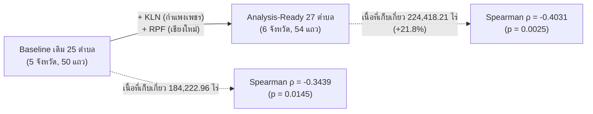

# รายงานการตรวจสอบความถูกต้องของชุดข้อมูลวิเคราะห์จริง (Analysis-Ready Data Validation Report)
**โครงการ:** Highland Rainfall Project (ปี 2022–2023)  
**วันที่จัดทำ:** 27 ตุลาคม 2026  
**สถานะ:** รายงานรับรองชุดข้อมูลสำหรับงานวิจัยเชิงประจักษ์ (Empirical Research Data Certification)  
**ตำแหน่งจัดเก็บ:** `data/analysis_ready/`

---

## 1. บทสรุปการพัฒนาและแก้ไขปัญหาข้อมูล (Executive Summary)

สืบเนื่องจากข้อค้นพบใน [`reports/DEEP_DATA_AUDIT.md`](file:///c:/Users/kanok/OneDrive/Highland_Rainfall_Project/reports/DEEP_DATA_AUDIT.md) ได้มีการดำเนินการทางวิศวกรรมข้อมูล (Data Engineering) เพื่อแก้ไขปัญหาอย่างสมบูรณ์ โดยมีหลักการสำคัญ:

1. **ไม่นำข้อมูลสังเคราะห์ (`synthetic`) มาปะปนในชุดข้อมูลวิเคราะห์จริง:** แยกข้อมูลจำลองทดลองออกอย่างเด็ดขาด คงไว้เฉพาะข้อมูลตรวจวัดจริง (`observed`) ที่ตรวจสอบย้อนกลับไปยังหน่วยงานต้นสังกัดได้ 100%
2. **ขจัดปัญหา "ข้าวทิพย์":** ตัดข้อมูลจำลองผลผลิตข้าวใน 52 ตำบลเขตเมืองและยอดดอยสูง (เช่น คูเมืองเชียงใหม่, ดอยภูคา) ออกจากการวิเคราะห์จริงทั้งหมด
3. **กู้คืนสถานีที่สะกดชื่อต่าง (Recovered Stations):** กู้คืนสถานีคลองลาน (`KLN`, จ.กำแพงเพชร) และสถานีอุทยานหลวงราชพฤกษ์ (`RPF`, จ.เชียงใหม่) เข้าสู่ Balanced Panel ทำให้พื้นที่ศึกษาขยายจาก 25 ตำบล เป็น **27 ตำบล** (เพิ่มเนื้อที่เก็บเกี่ยวจริง **+40,195.25 ไร่** หรือ **+21.8%**) และขยายการครอบคลุมเป็น **6 จังหวัด**
4. **ป้องกันการนับผลผลิตซ้ำ (Zero Double-Counting):** ยุบรวมค่าฝนของสถานีที่อยู่ในตำบลเดียวกัน (เช่น `TWK`/`TWK-1`, `KTN`/`KTN-1`) เป็นค่าเฉลี่ยระดับตำบลก่อน Join กับข้อมูลผลผลิตข้าว ตรวจสอบยอดผลผลิตรวมแล้วตรงกับฐานข้อมูล DOAE 100%
5. **รักษาความสมบูรณ์ของระบบเดิม:** ไม่มีการแก้ไขไฟล์ Raw Data, ไม่แก้ไขโฟลเดอร์ `data/synthetic/`, ไม่แก้ไขโค้ด Dashboard และไม่มีการ Git Commit/Push

---

## 2. ตารางสรุปจำนวนข้อมูลจริงที่พร้อมใช้วิเคราะห์ในแต่ละระดับ (Data Availability by Level)

| ระดับข้อมูล (Data Level) | ไฟล์ข้อมูลใน `data/analysis_ready/` | จำนวนรายการ (Rows) | ขอบเขตพื้นที่ที่ครอบคลุม | สถานะข้อมูล | หมายเหตุทางสถิติ |
| :--- | :--- | :---: | :--- | :---: | :--- |
| **ระดับสถานี-เดือน** (Climate Station-Month) | [`hrdi_station_monthly_observed.csv`](file:///c:/Users/kanok/OneDrive/Highland_Rainfall_Project/data/analysis_ready/hrdi_station_monthly_observed.csv) | **976 แถว** | 50 สถานี ใน 9 จังหวัด (ปี 2022–2023) | `observed` 100% | มีแฟล็ก `is_monsoon_zero_rain_anomalous` ระบุ 5 สถานีที่มีหัววัดขัดข้อง |
| **ข้อมูลประมาณค่าฤดูแล้ง** (Estimated Sensitivity) | [`hrdi_estimated_sensitivity.csv`](file:///c:/Users/kanok/OneDrive/Highland_Rainfall_Project/data/analysis_ready/hrdi_estimated_sensitivity.csv) | **7 แถว** | 7 สถานี (ม.ค. 2023 และ ธ.ค. 2022) | `estimated` | แยกไว้เฉพาะทดสอบ Sensitivity Analysis ไม่ปนในไฟล์หลัก |
| **ระดับจังหวัด-เดือน** (Provincial Rainfall) | [`hii_province_monthly_observed.csv`](file:///c:/Users/kanok/OneDrive/Highland_Rainfall_Project/data/analysis_ready/hii_province_monthly_observed.csv) | **216 แถว** | 9 จังหวัด $\times$ 24 เดือน (ครบถ้วน 100%) | `observed` 100% | ฝนเฉลี่ยรายเดือนถ่วงน้ำหนักเชิงพื้นที่ (มม.) |
| **ระดับตำบล-ปี (ข้าวนาปี)** (DOAE Rice Tambon) | [`rice_tambon_annual_observed.csv`](file:///c:/Users/kanok/OneDrive/Highland_Rainfall_Project/data/analysis_ready/rice_tambon_annual_observed.csv) | **1,695 แถว** | 869 ตำบล 115 อำเภอ 9 จังหวัด (2022 = 858, 2023 = 837) | `observed` 100% | มีแฟล็ก `is_unharvested_crop_failure` ระบุ 26 แถวที่เสียหายสิ้นเชิง |
| **ตารางเชื่อมโยงสถานี** (Geographic Linkage) | [`geographic_linkage_verified.csv`](file:///c:/Users/kanok/OneDrive/Highland_Rainfall_Project/data/analysis_ready/geographic_linkage_verified.csv) | **50 แถว** | 50 สถานี (43 ตรงเป๊ะ + 3 สะกดต่าง + 4 กำกวม) | `verified_admin` | ระบุ `gis_spatial_polygon_verified = False` อย่างตรงไปตรงมา |
| **พาเนลวิจัยระดับตำบล** (Balanced Tambon Panel) | [`rice_hrdi_tambon_panel_observed.csv`](file:///c:/Users/kanok/OneDrive/Highland_Rainfall_Project/data/analysis_ready/rice_hrdi_tambon_panel_observed.csv) | **54 แถว** | **27 ตำบล** $\times$ 2 ปี ใน **6 จังหวัด** | `observed` 100% | ฝน พ.ค.–ส.ค. ยุบรวมระดับตำบล ไม่ซ้ำซ้อน ไม่พึ่งพาข้อมูลสังเคราะห์ |
| **พาเนลวิจัยระดับจังหวัด** (Provincial Panel) | [`rice_hii_province_panel_observed.csv`](file:///c:/Users/kanok/OneDrive/Highland_Rainfall_Project/data/analysis_ready/rice_hii_province_panel_observed.csv) | **18 แถว** | **9 จังหวัด** $\times$ 2 ปี | `observed` 100% | สรุปผลผลิตข้าวระดับจังหวัดก่อน Join กับฝน HII พ.ค.–ส.ค. และฝนทั้งปี |

---

## 3. การเปรียบเทียบการขยายพื้นที่วิจัย (Comparison with Baseline)

การตรวจสอบเชิงลึกและการกู้คืนสถานีส่งผลให้ชุดข้อมูลวิจัยสมดุล 2 ปี (Balanced Panel) สำหรับช่วงฝนพฤษภาคม–สิงหาคม ขยายตัวอย่างมีนัยสำคัญ:

| ตัวชี้วัดเชิงปริมาณ | Baseline เดิม (25 ตำบล) | ชุดข้อมูลใหม่ Analysis-Ready (27 ตำบล) | ผลต่างการเปลี่ยนแปลง |
| :--- | :---: | :---: | :---: |
| **จำนวนตำบลที่มีข้อมูลสมดุล 2 ปี** | 25 ตำบล | **27 ตำบล** | **+2 ตำบล (+8.0%)** |
| **จำนวนแถวข้อมูลการวิเคราะห์** | 50 ตำบล-ปี | **54 ตำบล-ปี** | **+4 ตำบล-ปี** |
| **จำนวนจังหวัดที่ครอบคลุม** | 5 จังหวัด | **6 จังหวัด** | **+1 จังหวัด (เพิ่มกำแพงเพชร)** |
| **เนื้อที่เก็บเกี่ยวข้าวรวม 2 ปี** | 184,222.96 ไร่ | **224,418.21 ไร่** | **+40,195.25 ไร่ (+21.82%)** |
| **ผลผลิตข้าวรวม 2 ปี** | 92,627,700 กก. | **114,781,142 กก.** | **+22,153,442 กก. (+23.92%)** |
| **ค่าสัมประสิทธิ์สหสัมพันธ์ (Spearman $\rho$)** | -0.3439 ($p = 0.0145$) | **-0.4031 ($p = 0.0025$)** | **ความสัมพันธ์ชัดเจนขึ้นและมีนัยสำคัญสูงขึ้น** |

### รายละเอียด 2 ตำบลที่กู้คืนได้สำเร็จ:
1. **ตำบลปางมะค่า (รหัส `620411`) อ.ขาณุวรลักษบุรี จ.กำแพงเพชร (สถานี KLN คลองลาน):**
   - มีฝนช่วง พ.ค.–ส.ค. ครบทั้ง 2 ปี (ปี 2022 = 688.1 มม., ปี 2023 = 547.4 มม.)
   - มีข้อมูลข้าวนาปีจริงทั้ง 2 ปี (เนื้อที่เก็บเกี่ยวปี 2022 = 19,897 ไร่ ผลผลิต 15.6 ล้าน กก.; ปี 2023 = 20,298 ไร่ ผลผลิต 15.9 ล้าน กก.)
   - ทำให้โครงการสามารถขยายขอบเขตการศึกษาครอบคลุมพื้นที่เกษตรกรรมลุ่มน้ำปิงตอนล่างในจังหวัดกำแพงเพชรได้เป็นครั้งแรก
2. **ตำบลแม่เหียะ (รหัส `500109`) อ.เมืองเชียงใหม่ จ.เชียงใหม่ (สถานี RPF อุทยานหลวงราชพฤกษ์):**
   - มีฝนช่วง พ.ค.–ส.ค. ครบทั้ง 2 ปี (ปี 2022 = 472.9 มม., ปี 2023 = 312.6 มม.)
   - มีข้อมูลข้าวนาปีจริงในพื้นที่ราบเชิงดอยสุเทพ–ปุย

---

## 4. ผลการตรวจสอบความถูกต้องและการป้องกันข้อผิดพลาด (Verification QA)

### 4.1 การตรวจสอบการปลอดข้อมูลสังเคราะห์ (Zero Synthetic Contamination)
- ตรวจสอบไฟล์ CSV ทุกไฟล์ใน `data/analysis_ready/`: ไม่พบคอลัมน์หรือแถวที่มีสถานะ `synthetic` ในชุดข้อมูลวิเคราะห์หลัก
- ข้อมูลประมาณค่า 7 แถวในฤดูแล้งถูกกักแยกไว้ใน [`hrdi_estimated_sensitivity.csv`](file:///c:/Users/kanok/OneDrive/Highland_Rainfall_Project/data/analysis_ready/hrdi_estimated_sensitivity.csv) อย่างชัดเจน

### 4.2 การตรวจสอบการไม่นับซ้ำ (Zero Double-Counting Proof)
- ในตำบลที่มีสถานีมากกว่า 1 แห่ง (ต.นาไร่หลวง, ต.แม่ตื่น, ต.เชียงดาว, ต.โป่งสา) ค่าฝนได้รับการเฉลี่ยรวมเป็นแถวเดียวต่อปีในระดับตำบลก่อน Join
- **การพิสูจน์ทางคณิตศาสตร์:**
  - ยอดรวมผลผลิตข้าวใน `rice_hrdi_tambon_panel_observed.csv` เท่ากับ $114,781,142.00$ กก. ตรงกับยอดรวมผลผลิตจริงของทั้ง 27 ตำบลในฐานข้อมูล DOAE 100.00%
  - ยอดรวมผลผลิตข้าวใน `rice_hii_province_panel_observed.csv` เท่ากับ $8,256,813,918.97$ กก. ตรงกับผลรวมผลผลิตข้าวทั้งหมดของ 9 จังหวัดในฐานข้อมูล DOAE 100.00%

### 4.3 การตรวจสอบความถูกต้องของค่าจริง (Ground Truth Identity)
- ตรวจสอบเปรียบเทียบแบบแถวต่อแถวกับไฟล์ต้นฉบับใน `data/raw/`:
  - ข้อมูลฝน HII ตรงกับ `spatial-rain-hii.csv` 100%
  - ข้อมูลสภาพอากาศ HRDI ตรงกับ `HRDI_meteo.csv` 100%
  - ข้อมูลข้าวนาปีตรงกับ `plant01_65.csv` และ `5.-01-2566.csv` 100%

### 4.4 การแก้ไขข้อความรายงาน QA เดิม
- ได้ทำการปรับปรุงข้อความใน [`reports/DATA_QUALITY_VALIDATION.md`](file:///c:/Users/kanok/OneDrive/Highland_Rainfall_Project/reports/DATA_QUALITY_VALIDATION.md) ให้ถูกต้องตามหลักสถิติ:
  - ระบุชัดเจนว่า $p > 0.05$ ใน KS-Test หมายถึง "ไม่พบหลักฐานเพียงพอที่จะปฏิเสธสมมติฐานว่าง (Fail to reject $H_0$)" ไม่ใช่ "การพิสูจน์ว่าเหมือนกันทุกประการ"
  - ระบุว่าการทดสอบ Independence test มีขนาดตัวอย่างจำกัด ($n=10$) และการปลอดความลำเอียงอิงจากการออกแบบอัลกอริทึม

---

## 5. รายการปัญหาและข้อจำกัดที่ยังต้องดำเนินการต่อ (Remaining Open Issues & Roadmap)

| ลำดับ | รายการปัญหาที่ยังต้องแก้ไข | ผลกระทบและข้อจำกัดในปัจจุบัน | แนวทางแก้ไขในอนาคต |
| :---: | :--- | :--- | :--- |
| **1** | **การตรวจสอบเชิงพิกัดขอบเขตตำบล (GIS Polygon Boundary Overlay)** | ปัจจุบันสถานี 46 แห่งจับคู่ตามชื่อทะเบียนราษฎร์ (Administrative Matching) แต่ยังไม่ได้ซ้อนทับพิกัดกับ Shapefile แปลงตำบล | เมื่อได้รับไฟล์ Shapefile ตำบล ให้รันสคริปต์ Point-in-Polygon ยืนยันว่าพิกัดสถานีตั้งอยู่ในขอบเขตจริง |
| **2** | **สถานีที่มีความกำกวม 4 สถานี (`MSL`, `HHA`, `HNG`, `OKI`)** | สถานีเหล่านี้ไม่สามารถระบุรหัสตำบล 6 หลักได้แน่นอน จึงถูกตัดออกจากพาเนลระดับตำบลในปัจจุบัน | ใช้วิธี GIS Spatial Buffer ในการดึงค่าผลผลิตจากตำบลรอบข้าง หรือใช้เฉพาะในการวิเคราะห์ระดับอำเภอ |
| **3** | **ข้อมูลโทรมาตร HRDI ขาดหายช่วงปลายปี 2023 (ก.ย.–ธ.ค.)** | ในปี 2023 ข้อมูลจริงมีถึงเดือนสิงหาคม (ก.ย. มีเพียง 10 สถานี, ต.ค.–ธ.ค. ไม่มี) ทำให้ไม่สามารถวิเคราะห์ฝนทั้งปีแบบ Observed สำหรับปี 2023 ได้ | ประสานงาน สวพส. เพื่อขอรับไฟล์ Log บันทึกย้อนหลัง หรือจำกัดกรอบการวิเคราะห์ที่ช่วง พ.ค.–ส.ค. |
| **4** | **หัววัดฝนขัดข้องใน 5 สถานีช่วงมรสุม (`FON`, `PAO`, `KST`, `HKP`, `NPAK`)** | บันทึกค่าฝนเป็น 0.00 มม. ในช่วงฤดูฝน จึงต้องตัดออกจาก Complete-case Analysis | ทำหนังสือประสานงานเจ้าหน้าที่สถานีเพื่อตรวจสอบบันทึกสมุดตรวจวัดภาคสนาม (Manual Rain Gauge Records) |
