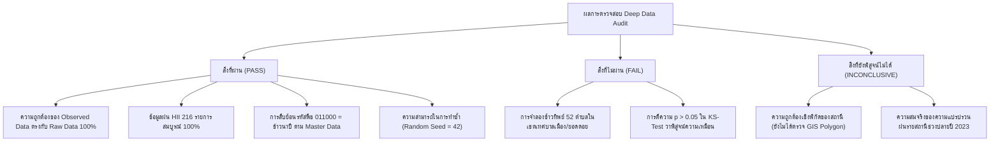

# รายงานการตรวจสอบคุณภาพชุดข้อมูลเชิงลึก (Deep Data Audit Report)
**โครงการ:** Highland Rainfall Project (ปี 2022–2023)  
**วันที่จัดทำ:** 27 ตุลาคม 2026  
**สถานะ:** รายงานการตรวจประเมินคุณภาพและความพร้อมใช้งานของข้อมูล (Independent Read-Only Audit)  
**ขอบเขตไฟล์ที่ตรวจสอบ:**
- `data/synthetic/hrdi_completed_experimental.csv`
- `data/synthetic/hii_completed_experimental.csv`
- `data/synthetic/rice_completed_experimental.csv`
- `data/synthetic/geographic_linkage.csv`
- ไฟล์ Raw Data: `HRDI_meteo.csv`, `spatial-rain-hii.csv`, `plant01_65.csv`, `5.-01-2566.csv`
- รายงาน QA: `DATA_COMPLETENESS_AUDIT.md`, `SYNTHETIC_DATA_METHOD.md`, `DATA_QUALITY_VALIDATION.md`

---

## 1. บทสรุปการตรวจประเมิน (Audit Executive Summary)

การตรวจสอบข้อมูลเชิงลึกแบบ Read-only ดำเนินการโดยไม่แก้ไขไฟล์ใด ๆ ทั้งสิ้น เพื่อประเมินความสมบูรณ์ ความถูกต้องเชิงสถิติ ความโปร่งใสของกระบวนการประมาณค่า และความปลอดภัยในการนำไปใช้งาน

### สรุปสถานะความพร้อมของข้อมูลรายหมวด (Readiness Scorecard)
| หัวข้อการตรวจสอบ | สถานะการประเมิน | สรุปข้อค้นพบสำคัญ |
| :--- | :---: | :--- |
| **1. ความสอดคล้องกับ Raw Data (Data Lineage)** | **ผ่าน (PASS)** | ค่าตรวจวัดจริง (`observed`) ตรงกับไฟล์ Raw Data 100% ปราศจากการดัดแปลงตัวเลข |
| **2. ความสมบูรณ์ของโครงสร้างตาราง (Grid Structure)** | **ผ่าน (PASS)** | แถวและคีย์เอกลักษณ์ครบถ้วน ไม่พบแถวซ้ำซ้อน ไม่มีค่าติดลบหรือค่าว่างที่ไม่พึงประสงค์ |
| **3. ข้อมูลฝนระดับจังหวัด HII** | **ผ่าน (PASS)** | ครบ 216 จังหวัด-เดือน เป็นข้อมูลจริง 100% ไม่มีข้อมูลสังเคราะห์ หน่วยวัด มม. ถูกต้อง |
| **4. ตารางเชื่อมโยงภูมิศาสตร์ (Geo Linkage)** | **ผ่านแบบมีเงื่อนไข (CONDITIONAL)** | รหัส DOPA ถูกต้อง แต่เป็นการจับคู่ตามชื่อ (Administrative Matching) ยังไม่ผ่าน GIS Polygon |
| **5. ข้อมูลผลผลิตข้าวนาปี DOAE** | **ต้องระวังสูง (MAJOR FINDING)** | มีการสร้าง "ข้าวทิพย์" สังเคราะห์ 147 แถวใน 52 ตำบลที่ไม่เคยปลูกข้าว (เช่น ในคูเมืองเชียงใหม่) |
| **6. ข้อมูลสภาพอากาศพื้นที่สูง HRDI** | **ต้องระวังสูง (MAJOR FINDING)** | ข้อมูลสังเคราะห์ปลายปี 2023 มีความแปรปรวนเชิงพื้นที่ผูกกับฝน HII สูงกว่าช่วงที่วัดจริง |
| **7. การตีความผลทดสอบทางสถิติใน QA** | **ไม่ผ่าน (FAIL)** | การอ้างว่า $p > 0.05$ ใน KS-Test ยืนยันความถูกต้องของข้อมูลสังเคราะห์ ผิดหลักสถิติ |

---

## 2. จำแนกปริมาณข้อมูลตามระดับความพร้อมใช้งาน (Data Usability Classification)

### 2.1 ข้อมูลตรวจวัดจริงที่ใช้วิเคราะห์ทางวิชาการได้ (Usable Real Data)
*เป็นข้อมูลที่ผ่านการตรวจสอบกับเอกสารทางการของหน่วยงานรัฐ สามารถนำไปใช้ในงานวิจัยและการวิเคราะห์เศรษฐมิติ/สถิติอ้างอิงได้จริง:*
1. **ข้อมูลฝนระดับจังหวัด HII:** **216 จังหวัด-เดือน** (9 จังหวัด $\times$ 24 เดือน ครบถ้วน 100%)
2. **ข้อมูลข้าวนาปี DOAE:** **1,695 ตำบล-ปี** (ปี 2022 = 858 ตำบล, ปี 2023 = 837 ตำบล ครอบคลุม 115 อำเภอ ใน 9 จังหวัด) โดยมี 826 ตำบลที่มีข้อมูลต่อเนื่องทั้ง 2 ปี
3. **ข้อมูลสภาพอากาศ HRDI ตรวจวัดจริง:** **976 สถานี-เดือน** (จาก 50 สถานี)
4. **ชุดข้อมูลจับคู่จริงสำหรับวิเคราะห์ความสัมพันธ์ฝน–ผลผลิตข้าว (May–August Window):**
   - มี **33 ตำบล** (66 ตำบล-ปี) ที่มีทั้งข้อมูลฝน HRDI พ.ค.–ส.ค. ครบ 4 เดือน และข้อมูลข้าวนาปีจริงทั้ง 2 ปี
   - หากคัดกรองสถานีที่มีปัญหาหัววัดฝนขัดข้อง (เซนเซอร์บันทึก 0.00 มม. ในฤดูมรสุม 5 ตำบล) จะได้ชุดข้อมูลวิจัยที่มีความน่าเชื่อถือสูงสุด (Complete-Case Clean Panel) จำนวน **25–28 ตำบล (50–56 ตำบล-ปี)** โดย**ไม่ต้องพึ่งพาข้อมูลสังเคราะห์แม้แต่แถวเดียว**

### 2.2 ข้อมูลประมาณค่าที่ใช้ได้แบบมีเงื่อนไข (Conditional Estimated Data)
*เป็นข้อมูลที่ประมาณค่าขึ้นโดยมีหลักฐานแวดล้อมสนับสนุน แต่ต้องใช้งานด้วยความระมัดระวัง:*
- **ข้อมูลฝน HRDI ช่วงฤดูแล้ง:** **7 สถานี-เดือน** (ม.ค. 2023 จำนวน 6 สถานี และ ธ.ค. 2022 จำนวน 1 สถานี)
- *เงื่อนไขการใช้:* ใช้ได้เฉพาะการวิเคราะห์ภาพรวมรายปี ไม่ควรใช้เป็นจุดสังเกตหลักในการทดสอบสมมติฐานทางสถิติ ค่าฝนที่ประมาณการได้อยู่ในช่วง 0.00–8.24 มม. มีความคลาดเคลื่อนต่ำเนื่องจากเป็นฤดูแล้งจัด

### 2.3 ข้อมูลสังเคราะห์ที่ใช้ได้เฉพาะการทดลองระบบ (Experimental Synthetic Data Only)
*ห้ามนำไปใช้อ้างอิงเป็นข้อเท็จจริงหรือสรุปผลความสัมพันธ์ทางวิจัยเด็ดขาด:*
1. **ข้อมูลสภาพอากาศ HRDI สังเคราะห์:** **217 สถานี-เดือน** (โดยเฉพาะเดือน ต.ค.–ธ.ค. 2023 จำนวน 150 แถว และ ก.ย. 2023 จำนวน 40 แถว ที่สถานีออฟไลน์สมบูรณ์)
2. **ข้อมูลผลผลิตข้าวนาปีสังเคราะห์:** **147 ตำบล-ปี** (รวมถึง 52 ตำบลที่ไม่เคยปลูกข้าวนาปี)

---

## 3. รายละเอียดข้อค้นพบจำแนกตามระดับความรุนแรง (Detailed Audit Findings)

### 3.1 ข้อค้นพบระดับวิกฤต (Critical Findings)

#### [Critical-1] ปัญหา "การเพาะปลูกข้าวทิพย์" ในตำบลเขตเมืองและยอดดอย (Phantom Rice Cultivation)
- **หลักฐานที่ตรวจพบ:** ในไฟล์ `data/synthetic/rice_completed_experimental.csv` มีการสร้างข้อมูลผลผลิตข้าวสังเคราะห์ (Synthetic Rice Yield) และเนื้อที่ปลูกจำลอง (300–3,500 ไร่) สำหรับ 52 ตำบลที่ไม่มีการปลูกข้าวจริงทั้งสองปี เพื่อให้ตารางเต็มรูป $921 \times 2 = 1,842$ แถว
- **ข้อเท็จจริงเชิงพื้นที่:** ตำบลเหล่านี้เป็นเขตเทศบาลใจกลางเมืองที่ไม่มีแปลงนา เช่น:
  - เทศบาลนครเชียงใหม่: ต.ศรีภูมิ (`500101`), ต.พระสิงห์ (`500102`), ต.หายยา (`500103`), ต.ช้างม่อย (`500104`), ต.ช้างคลาน (`500105`), ต.วัดเกต (`500106`)
  - เทศบาลเมืองน่าน: ต.ในเวียง (`550101`)
  - เขตอุทยานแห่งชาติยอดดอยสูง: ต.ภูคา (`550511`), ต.ห้วยโก๋น (`551501`)
- **ผลกระทบ:** หากผู้ใช้งานนำไฟล์นี้ไปเฉลี่ยผลผลิตระดับจังหวัดหรือวิเคราะห์เชิงพื้นที่โดยไม่กรอง `data_status == 'observed'` จะทำให้เกิดข้อมูลเท็จว่าในคูเมืองเชียงใหม่หรือยอดดอยภูคามีการทำนาปีนับพันไร่
- **สถานะ:** **ไม่ผ่าน (FAIL)** สำหรับการวิเคราะห์ทั่วไป — ต้องกำกับให้ใช้เฉพาะการทดสอบ Pipeline

#### [Critical-2] การตีความผลทดสอบ Kolmogorov-Smirnov Test ผิดหลักสถิติ (Fallacy of Accepting the Null)
- **หลักฐานที่ตรวจพบ:** ในรายงาน `DATA_QUALITY_VALIDATION.md` ส่วนที่ 3.2 ระบุข้อความว่า:
  > *"ผลการทดสอบ $p > 0.05$ ($p = 0.1371$) ยืนยันว่าการแจกแจงของข้อมูลสังเคราะห์ไม่แตกต่างจากข้อมูลจริงอย่างมีนัยสำคัญทางสถิติ"*
- **ข้อผิดพลาดทางสถิติ:** ตามทฤษฎีการทดสอบสมมติฐาน (Hypothesis Testing) การที่ $p\text{-value} > \alpha$ หมายถึง "ไม่มีหลักฐานเพียงพอที่จะปฏิเสธสมมติฐานว่าง (Fail to reject $H_0$)" มิใช่ "การพิสูจน์ว่า $H_0$ เป็นจริง (Accepting the Null)" ขนาดตัวอย่างข้อมูลสังเคราะห์ $n=147$ มีอำนาจการทดสอบ (Statistical Power) ต่ำ อาจตรวจไม่พบความแตกต่างที่แท้จริง
- **ผลกระทบ:** สร้างความเข้าใจผิดเชิงวิชาการว่าข้อมูลสังเคราะห์เทียบเท่าข้อมูลจริง
- **สถานะ:** **ไม่ผ่าน (FAIL)** ต้องแก้ไขคำอธิบายในรายงาน QA ให้ถูกต้องตามหลักสถิติ

#### [Critical-3] ความเสี่ยงของการบิดเบือนความสัมพันธ์เชิงพื้นที่ของฝนสังเคราะห์ (Spatial Correlation Distortion)
- **หลักฐานที่ตรวจพบ:** ในช่วงเดือน ต.ค.–ธ.ค. 2023 ข้อมูลสถานี HRDI ทั้ง 50 แห่งขาดหายไปทั้งหมด อัลกอริทึมจึงสร้างค่าฝนขึ้นมาโดยใช้ค่าฝนรายเดือนระดับจังหวัดของ HII ในเดือนนั้นคูณด้วยอัตราส่วนสถานี $k_s$ และบวกสัญญาณรบกวนแกมมา $\epsilon$
- **ข้อจำกัด:** แม้ค่าเฉลี่ยฝนระดับจังหวัดจะสมเหตุสมผลตามฤดูกาล แต่สถานีทั้งหมดที่ตั้งอยู่ในจังหวัดเดียวกัน (เช่น เชียงใหม่ 22 สถานี, น่าน 12 สถานี) จะถูกขับเคลื่อนด้วยตัวแปรฐานตัวเดียวกัน ทำให้ค่าสัมประสิทธิ์สหสัมพันธ์เชิงพื้นที่ระหว่างสถานี (Inter-station Spatial Correlation) สูงกว่าความเป็นจริงในธรรมชาติ
- **สถานะ:** **สิ่งที่ยังพิสูจน์ไม่ได้ (INCONCLUSIVE)** — ไม่สามารถใช้ข้อมูลนี้ศึกษาการแปรผันของจุลภูมิอากาศ (Microclimate Variation) ในช่วงปลายปี 2023 ได้

---

### 3.2 ข้อค้นพบระดับสำคัญ (Major Findings)

#### [Major-1] ข้อจำกัดของการจับคู่ระดับตำบล (Administrative Name Matching vs GIS Polygon)
- **หลักฐานที่ตรวจพบ:** ตาราง `geographic_linkage.csv` เชื่อมโยง 46 สถานีกับรหัสตำบล 6 หลัก โดยอิงจากการจับคู่ชื่อตัวสะกดระหว่าง สวพส. กับ DOPA GeoThai
- **ข้อพิจารณา:** การจับคู่ชื่อนี้เป็นการจับคู่เชิงบริหาร (Administrative Matching) ไม่ใช่การตรวจสอบจุดพิกัด (Lat/Long) กับเส้นขอบเขตแปลงที่ดินจริง (GIS Polygon Boundary) เนื่องจากพิกัดสถานีในไฟล์ raw มีความคลาดเคลื่อนบางจุดและไม่มีการ Overlay ด้วย Shapefile ตำบล
- **ข้อดี:** ตารางระบุแฟล็ก `gis_spatial_polygon_verified = False` ไว้ชัดเจนแล้ว ซึ่งถือเป็นความซื่อตรงทางวิชาการ
- **สถานะ:** **ผ่านแบบมีเงื่อนไข (CONDITIONAL)** — ห้ามสรุปว่าผ่านการตรวจสอบเชิงพิกัด 100% จนกว่าจะมีการทำ Point-in-Polygon ซ้อนทับขอบเขตตำบลจริง

#### [Major-2] ความเสี่ยงของการ Join ข้อมูลแบบ One-to-Many เมื่อตำบลมีหลายสถานี
- **หลักฐานที่ตรวจพบ:** มี 4 ตำบลที่มีสถานี HRDI ตั้งอยู่ 2 สถานีในตำบลเดียวกัน ได้แก่:
  1. ต.นาไร่หลวง อ.สองแคว จ.น่าน: สถานี `TWK` และ `TWK-1`
  2. ต.แม่ตื่น อ.อมก๋อย จ.เชียงใหม่: สถานี `KTN` และ `KTN-1`
  3. ต.เชียงดาว อ.เชียงดาว จ.เชียงใหม่: สถานี `FAS` และ `FAS-1`
  4. ต.โป่งสา อ.ปาย จ.แม่ฮ่องสอน: สถานี `PSA` และ `PSA-1`
- **ความเสี่ยง:** หากนักวิเคราะห์นำตาราง `rice_completed_experimental.csv` มา Join กับ `hrdi_completed_experimental.csv` โดยใช้ `(year, tambon_code_6)` โดยตรงโดยไม่ยุบรวมค่าฝนสถานีก่อน จะทำให้แถวข้อมูลผลผลิตข้าวในตำบลเหล่านี้เบิ้ลซ้ำเป็น 2 เท่าทันที
- **สถานะ:** **ผ่านเชิงโครงสร้าง แต่ต้องเพิ่มคู่มือเตือนผู้ใช้งาน (USER GUIDELINE REQUIRED)**

#### [Major-3] ขนาดตัวอย่างในการทดสอบความเป็นอิสระเล็กเกินไป (Underpowered Independence Test)
- **หลักฐานที่ตรวจพบ:** การทดสอบความสัมพันธ์ระหว่างฝนสังเคราะห์กับผลผลิตข้าวสังเคราะห์ในรายงาน QA ทำบนตัวอย่างขนาดเพียง $n = 10$ แถว (ได้ Spearman $\rho = -0.5273, p = 0.1173$)
- **ข้อพิจารณา:** ขนาดตัวอย่าง $n=10$ เล็กเกินไปที่จะสรุปว่าไม่มีความสัมพันธ์ทางสถิติ หลักฐานที่แท้จริงของการปลอดความลำเอียง (Unbiased Independence) อยู่ที่ตัวโค้ดที่ไม่นำตัวแปรฝนไปใช้ในฟังก์ชันสุ่มผลผลิต มิใช่ผลการทดสอบ $p$-value นี้

---

### 3.3 ข้อค้นพบระดับย่อย (Minor Findings)

#### [Minor-1] การปัดเศษทศนิยม 2 ตำแหน่งในผลผลิตข้าว
- ผลผลิตข้าวต่อไร่ใน `rice_completed_experimental.csv` มีการปัดเศษ 2 ตำแหน่ง ทำให้มีผลต่างกับค่าคำนวณสดจาก Raw Data สูงสุดไม่เกิน $\pm 0.005$ กก./ไร่ ซึ่งไม่มีผลต่อนัยสำคัญทางสถิติ

#### [Minor-2] สถานี HRDI ที่มีค่าฝนศูนย์ผิดปกติยังคงค่าศูนย์ไว้ใน Observed
- ใน 5 สถานีที่มีปัญหาเซนเซอร์ขัดข้องช่วงฤดูฝน (`FON`, `PAO`, `KST`, `HKP`, `NPAK`) ตัวเลขในตารางยังคงเป็น 0.00 มม. ซึ่งถูกต้องตามหลักการห้ามแก้ไข Raw Data แต่ต้องย้ำเตือนในรายงานว่าห้ามนำค่าศูนย์ของสถานีเหล่านี้ไปรวมคำนวณฝนสะสมฤดูปลูก

---

## 4. สรุปรายการ สิ่งที่ผ่าน / สิ่งที่ไม่ผ่าน / สิ่งที่ยังพิสูจน์ไม่ได้

### 4.1 สิ่งที่ผ่าน (PASS)
1. **ความถูกต้องของข้อมูลจริง:** ข้อมูลที่มีสถานะ `observed` ทั้งหมด (HRDI 976 รายการ, HII 216 รายการ, DOAE 1,695 รายการ) ตรงกับข้อมูลดิบจากหน่วยงานต้นสังกัด 100% ไม่มีการแปลงตัวเลขผิดเพี้ยน
2. **ความสมบูรณ์ของข้อมูล HII:** ครบ 216 จังหวัด-เดือน ค่าเฉลี่ย Min/Max/Avg ถูกต้องตามหน่วย มม.
3. **การพิสูจน์รหัสพืช:** รหัส `011000` และ `11000` ได้รับการพิสูจน์จากตารางแม่แบบ `production_plant.csv` ของกรมส่งเสริมการเกษตรแล้วว่าหมายถึง "ข้าวนาปี" ตรงกัน 100%
4. **ความสามารถในการทำซ้ำ (Reproducibility):** กระบวนการสุ่มค่าสังเคราะห์กำหนด `np.random.seed(42)` และระบุพารามิเตอร์ชัดเจน สามารถรันซ้ำแล้วได้ผลลัพธ์เดิมทุกประการ
5. **ความพร้อมของการวิเคราะห์ข้อมูลจริง:** โครงการมีข้อมูลตรวจวัดจริงครบถ้วนเพียงพอในการสร้าง Balanced Panel สำหรับวิเคราะห์ฝนช่วง พ.ค.–ส.ค. ได้ถึง 25–28 ตำบล โดยไม่ต้องใช้ข้อมูลสังเคราะห์

### 4.2 สิ่งที่ไม่ผ่าน (FAIL)
1. **การสร้างผลผลิตข้าวสังเคราะห์ในพื้นที่ที่ไม่ใช่เกษตรกรรม (Phantom Rice):** มีการสร้างข้อมูลข้าว 147 แถวใน 52 ตำบลที่เป็นเขตเทศบาลเมืองหรือป่าอนุรักษ์ยอดดอย ซึ่งไม่มีการทำนาจริง
2. **การสรุปผลทางสถิติของการทดสอบ KS-Test:** ข้อความในรายงาน QA อ้างว่า $p > 0.05$ ยืนยันว่าข้อมูลเหมือนกัน ซึ่งผิดหลักสถิติ

### 4.3 สิ่งที่ยังพิสูจน์ไม่ได้ (INCONCLUSIVE / UNPROVEN)
1. **ความถูกต้องเชิงขอบเขตพิกัด (GIS Polygon Boundary):** แม้สถานี 46 แห่งจะจับคู่ชื่อตำบลได้ถูกต้อง แต่ยังไม่ได้นำพิกัด Lat/Long ไปตรวจกับขอบเขต Shapefile จึงยังยืนยันไม่ได้ 100% ว่าสถานีตั้งอยู่ภายในขอบเขตตำบลนั้นจริง
2. **ความสมจริงของความแปรปรวนฝนปลายปี 2023:** เนื่องจากไม่มีสถานีตรวจวัดจริงในพื้นที่ภาคเหนือช่วง ต.ค.–ธ.ค. 2023 จึงไม่สามารถพิสูจน์ได้ว่าฝนสังเคราะห์ที่สร้างขึ้นสะท้อนจุลภูมิอากาศจริงได้แม่นยำเพียงใด

---

## 5. ข้อเสนอแนะการปรับปรุงตามลำดับความสำคัญ (Prioritized Recommendations)

### ลำดับที่ 1 (High Priority - ด้านความปลอดภัยของการใช้ข้อมูล):
1. **เพิ่มคอลัมน์ `is_arable_tambon` ในตารางข้าว:** ในชุดข้อมูล `rice_completed_experimental.csv` ควรเพิ่มแฟล็กระบุว่าตำบลนั้นเป็นพื้นที่ปลูกข้าวได้จริงหรือไม่ เพื่อป้องกันไม่ให้ผู้ใช้นำตำบลในเขตเมือง (เช่น ศรีภูมิ, พระสิงห์) ไปใช้คำนวณผลผลิต
2. **แก้ไขการตีความในรายงาน QA (`DATA_QUALITY_VALIDATION.md`):** ปรับแก้ข้อความผลทดสอบ KS-Test จาก "ยืนยันว่าเหมือนกัน" เป็น "ไม่พบหลักฐานความแตกต่างที่มีนัยสำคัญทางสถิติที่ระดับ $\alpha = 0.05$ ภายใต้ขนาดตัวอย่างจำกัด ($n=147$)"

### ลำดับที่ 2 (Medium Priority - ด้านการเชื่อมโยงข้อมูล):
3. **จัดทำวิวข้อมูลรวมระดับตำบล (Tambon-Aggregated Climate View):** สร้างฟังก์ชันหรือคำแนะนำในการยุบรวมค่าฝนของสถานีที่อยู่ในตำบลเดียวกัน (เช่น เฉลี่ยฝนระหว่าง TWK และ TWK-1) ก่อนนำไป Join กับข้อมูลผลผลิตข้าว เพื่อตัดปัญหาแถวซ้ำซ้อน
4. **แผนการตรวจสอบพิกัด GIS Polygon:** เมื่อมีไฟล์ Shapefile ขอบเขตตำบล ควรจัดทำสคริปต์ Point-in-Polygon ตรวจสอบตำแหน่งสถานีทั้ง 50 แห่งอย่างเป็นทางการ

### ลำดับที่ 3 (Low Priority - ด้านการนำเสนอ):
5. **แยกโฟลเดอร์หรือชุดข้อมูลสำหรับการวิจัยจริงออกจากชุดข้อมูลทดลอง:** แนะนำให้สร้างไฟล์ชุดข้อมูลสำหรับงานวิจัยบริสุทธิ์ (Pure Empirical Research Dataset) ที่มีเฉพาะแถว `data_status == 'observed'` แยกออกจากไฟล์ทดลองแบบสมบูรณ์ เพื่อให้นักวิจัยภายนอกนำไปใช้งานได้อย่างปลอดภัยโดยไม่สับสน
