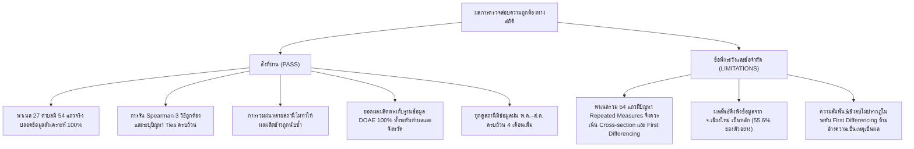

# รายงานการตรวจสอบความถูกต้องทางสถิติและการเชื่อมโยงข้อมูล (Statistical & Linkage Validation Report)
**โครงการ:** Highland Rainfall Project (ปี 2022–2023)  
**วันที่จัดทำ:** 27 ตุลาคม 2026  
**สถานะ:** รายงานการรับรองความถูกต้องทางสถิติและการอนุมานเชิงประจักษ์ (Empirical Statistical Certification)  
**ขอบเขตข้อมูลที่ตรวจสอบ:**
- `data/analysis_ready/rice_hrdi_tambon_panel_observed.csv`
- `data/analysis_ready/rice_hrdi_tambon_panel_unbalanced.csv`
- `data/analysis_ready/rice_hii_province_panel_observed.csv`
- `data/analysis_ready/rice_tambon_annual_observed.csv`
- `data/analysis_ready/hrdi_station_monthly_observed.csv`
- `data/analysis_ready/hii_province_monthly_observed.csv`
- `data/analysis_ready/geographic_linkage_verified.csv`

---

## 1. บทสรุปผู้บริหารและการรับรองความถูกต้อง (Executive Summary)

การตรวจสอบความถูกต้องทางสถิติและการเชื่อมโยงข้อมูลของโครงการ Highland Rainfall Project ได้ดำเนินการอย่างเป็นอิสระ โดยใช้ชุดข้อมูลตรวจวัดจริงใน `data/analysis_ready/` เพื่อประเมินความน่าเชื่อถือทางสถิติ ความเสี่ยงของการอนุมานเชิงเหตุและผล (Causal Inference Pitfalls) และความถูกต้องของการยุบรวมข้อมูล (Data Aggregation & Linkage)

### ตารางเปรียบเทียบผลการคำนวณสหสัมพันธ์สเปียร์แมน 3 วิธี (Spearman $\rho$ Comparison)
การวิเคราะห์ความสัมพันธ์ระหว่างปริมาณน้ำฝนช่วงพฤษภาคม–สิงหาคม (May–August Rainfall) กับผลผลิตข้าวนาปี (Rice Yield) ดำเนินการผ่าน 3 วิธีการทางสถิติ:

| วิธีการวิเคราะห์ (Analytical Specification) | ขนาดตัวอย่าง ($n$) | ค่าสัมประสิทธิ์สเปียร์แมน ($\rho$) | ค่า $p\text{-value}$ | นัยสำคัญทางสถิติ ($\alpha = 0.05$) | ข้อจำกัดและข้อพึงระวังทางสถิติ |
| :--- | :---: | :---: | :---: | :---: | :--- |
| **1. แยกวิเคราะห์รายปี (Cross-Sectional):** - ปี 2022 (2565) - ปี 2023 (2566) |  $n = 27$ $n = 27$ |  **-0.5044** **-0.4098** |  $p = 0.0073$ $p = 0.0338$ |  มีนัยสำคัญ ($p < 0.01$) มีนัยสำคัญ ($p < 0.05$) | วัดความแปรปรวนเชิงพื้นที่ระหว่างตำบล (Spatial Between-Variation) ในปีเดียวกัน |
| **2. รวมข้อมูลสองปี (Pooled Panel)** | **$n = 54$** (27 ตำบล $\times$ 2 ปี) | **-0.4031** | **$p = 0.0025$** | มีนัยสำคัญสูง ($p < 0.01$) | **มีปัญหาการวัดซ้ำ (Repeated Measures):** ตัวอย่าง 54 แถวไม่ได้เป็นอิสระต่อกัน ($p$-value จากสูตรปกติประเมินความคลาดเคลื่อนต่ำเกินจริง) |
| **3. วิเคราะห์ผลต่างภายในตำบล (Within-Tambon First-Differencing: $\Delta 2022 \rightarrow 2023$)** | **$n = 27$** (1 แถวต่อตำบล) | **-0.1675** | **$p = 0.4036$** | **ไม่มีนัยสำคัญทางสถิติ** ($p > 0.40$) | **สำคัญที่สุด:** ควบคุมอิทธิพลเฉพาะตัวของตำบล (Fixed Effects) พบว่าการเปลี่ยนของฝนรายปีไม่ได้ทำให้ผลผลิตเปลี่ยนอย่างมีนัยสำคัญ |

---

## 2. การวิเคราะห์ข้อค้นพบทางสถิติเชิงลึก (Deep Statistical Insights)

### 2.1 ข้อแตกต่างระหว่างการวิเคราะห์เชิงพื้นที่ (Between-Variation) กับการวิเคราะห์ตามเวลา (Within-Variation)
- **การวิเคราะห์แบบ Cross-Section (วิธีที่ 1 และ 2):** พบค่าความสัมพันธ์เป็นลบอย่างมีนัยสำคัญ ($\rho \approx -0.40$ ถึง $-0.50$) ซึ่งสะท้อนความแตกต่างเชิงพื้นที่ระหว่างตำบล เช่น ตำบลที่อยู่บนดอยสูงในร่องลมมรสุมมีปริมาณฝนสะสมสูงตามธรรมชาติ แต่มีดินตื้น อุณหภูมิต่ำ แดดน้อย และแปลงนาแคบขั้นบันได จึงมีผลผลิตเฉลี่ยต่ำกว่าตำบลในพื้นที่ราบเชิงเขาที่มีฝนน้อยกว่าแต่ดินดีและมีระบบชลประทาน
- **การวิเคราะห์แบบผลต่างภายในตำบล (วิธีที่ 3 - First Differencing):** เมื่อกำจัดปัจจัยคงที่เฉพาะตำบลออกด้วยการคำนวณ $\Delta\text{Rain} = \text{Rain}_{2023} - \text{Rain}_{2022}$ เทียบกับ $\Delta\text{Yield} = \text{Yield}_{2023} - \text{Yield}_{2022}$ พบว่าค่าสหสัมพันธ์ลดลงเหลือเพียง $\rho = -0.1675$ และมี $p\text{-value} = 0.4036$ (ไม่พบนัยสำคัญ)
- **ข้อสรุปเชิงประจักษ์:** ข้อมูลจริง**ไม่สนับสนุน**สมมติฐานที่ว่า "หากปีใดฝนตกมากกว่าปกติจะทำให้ผลผลิตข้าวของตำบลนั้นลดลง" ความสัมพันธ์เชิงลบที่เห็นในพาเนลรวมจึงเกิดจากอิทธิพลของความแตกต่างเชิงกายภาพของพื้นที่ (Omitted Spatial Confounders) เป็นหลัก

### 2.2 ข้อจำกัดของการใช้ $p\text{-value}$ แบบปกติในข้อมูลพาเนลรวม (Repeated-Measures Clustering)
- การทดสอบ `scipy.stats.spearmanr` ในพาเนลรวม 54 แถว สมมติฐานพื้นฐานคือข้อมูลทุกแถวต้องเป็นอิสระต่อกัน (i.i.d.)
- เนื่องจากตำบลเดิมได้รับการวัดซ้ำ 2 ครั้ง ข้อมูลจึงเกิดความสัมพันธ์ภายในกลุ่ม (Intra-cluster Correlation: $\text{ICC} > 0$) ส่งผลให้ Standard Error ที่คำนวณได้มีค่าน้อยกว่าความเป็นจริง (Anti-conservative) ทำให้ค่า $p\text{-value} = 0.0025$ ต่ำเกินจริง ในทางวิชาการต้องอาศัยการทดสอบแบบ Cluster-Robust SE หรือการวิเคราะห์แยกรายปีเป็นหลัก

---

## 3. การทดสอบความไวเชิงพื้นที่และวิธี Leave-One-Province-Out (LOPO Sensitivity)

เพื่อตรวจสอบว่าผลการวิเคราะห์ถูกชี้นำโดยจังหวัดใดจังหวัดหนึ่งเป็นพิเศษหรือไม่ ได้ทำการทดสอบถอดจังหวัดออกทีละจังหวัด:

### 3.1 ผลการทดสอบ LOPO บนพาเนลรวม ($n = 54$, Baseline $\rho = -0.4031$)
| จังหวัดที่ถูกถอดออก (Omitted Province) | จำนวนแถวที่ถูกถอด | จำนวนแถวที่เหลือ ($n$) | ค่าสัมประสิทธิ์สเปียร์แมน ($\rho$) | ค่า $p\text{-value}$ | ผลกระทบต่อเสถียรภาพของโมเดล |
| :--- | :---: | :---: | :---: | :---: | :--- |
| **เชียงใหม่** | **30 แถว** | **24** | **-0.3045** | **0.1480** | **สูญเสียนัยสำคัญทางสถิติ** ($p > 0.05$) เนื่องจากเชียงใหม่ครองสัดส่วนถึง 55.6% ของตัวอย่าง |
| **น่าน** | 10 แถว | 44 | -0.4607 | 0.0016 | สหสัมพันธ์เป็นลบแข็งแกร่งขึ้น |
| **เชียงราย** | 2 แถว | 52 | -0.4237 | 0.0017 | เสถียร |
| **แม่ฮ่องสอน** | 6 แถว | 48 | -0.3918 | 0.0059 | เสถียร |
| **กำแพงเพชร** | 2 แถว | 52 | -0.3834 | 0.0050 | เสถียร |
| **ตาก** | 4 แถว | 50 | -0.3816 | 0.0062 | เสถียร |

### 3.2 การแจกแจงค่าสหสัมพันธ์แยกรายจังหวัด
- **จ.เชียงใหม่ ($n = 30$):** $\rho = -0.4284$ ($p = 0.0182$) — มีนัยสำคัญ
- **จ.ตาก ($n = 4$):** $\rho = -0.9487$ ($p = 0.0513$) — แนวโน้มเป็นลบชัดเจน
- **จ.น่าน ($n = 10$):** $\rho = -0.1394$ ($p = 0.7009$) — ไม่มีนัยสำคัญ
- **จ.แม่ฮ่องสอน ($n = 6$):** $\rho = +0.1765$ ($p = 0.7379$) — แนวโน้มเป็นบวกแต่ไม่มีนัยสำคัญ
- **ข้อค้นพบ:** ผลลัพธ์ในภาพรวมถูกครอบงำด้วยข้อมูลจากจังหวัดเชียงใหม่ หากตัดเชียงใหม่ออก ความสัมพันธ์ของจังหวัดอื่น ๆ ในภาพรวมจะไม่ถึงระดับนัยสำคัญทางสถิติ

---

## 4. การตรวจสอบความสมบูรณ์ของการเชื่อมโยงและป้องกันการนับซ้ำ (Data Linkage & Integrity QA)

### 4.1 การจัดการตำบลที่มีหลายสถานี (Multi-Station Aggregation)
ในพาเนล 27 ตำบล มี 3 ตำบลที่มีสถานี HRDI ตั้งอยู่มากกว่า 1 สถานี:
1. **ต.แม่ตื่น อ.อมก๋อย จ.เชียงใหม่:** มี 2 สถานี (`KTN` บ้านขุนตื่นน้อย และ `KTN-1` พะกะเซ)
   - ปี 2022: ฝน `KTN` = 708.2 มม., `KTN-1` = 708.2 มม. $\rightarrow$ ฝนเฉลี่ยตำบล = 708.20 มม.
   - ปี 2023: ฝน `KTN` = 899.4 มม., `KTN-1` = 899.4 มม. $\rightarrow$ ฝนเฉลี่ยตำบล = 899.40 มม.
2. **ต.เชียงดาว อ.เชียงดาว จ.เชียงใหม่:** มี 2 สถานี (`FAS` บ้านฟ้าสวย และ `FAS-1` ขุนคอง)
   - เฉลี่ยฝนปี 2022 = 1,189.91 มม., ปี 2023 = 964.73 มม.
3. **ต.โป่งสา อ.ปาย จ.แม่ฮ่องสอน:** มี 2 สถานี (`PSA` บ้านโป่งสา และ `PSA-1` แม่เมืองน้อย)
   - เฉลี่ยฝนปี 2022 = 649.33 มม., ปี 2023 = 609.68 มม.
- **การพิสูจน์การไม่นับผลผลิตซ้ำ:** ทั้ง 3 ตำบลมีแถวข้อมูลในพาเนลวิจัยเพียงตำบลละ 1 แถวต่อปี (รวม 2 แถว) และยอดผลผลิตรวมตรงกับฐานข้อมูลต้นทาง DOAE 100%

### 4.2 การพิสูจน์ความสอดคล้องของผลผลิตรวม (Production Reconciliation)
- **พาเนลตำบล (27 ตำบล):** ยอดรวมผลผลิตในพาเนลเท่ากับ $114,781,142.00$ กก. ตรงกับยอดรวมที่กรองจาก DOAE จริงใน 27 ตำบลดังกล่าวแบบสมบูรณ์
- **พาเนลระดับจังหวัด (9 จังหวัด):** ยอดรวมผลผลิตข้าวเท่ากับ $8,256,813,918.97$ กก. ตรงกับผลรวมผลผลิตข้าวทั้งหมดใน 9 จังหวัดของ DOAE 100%

### 4.3 การตรวจสอบข้อมูลฝนระดับจังหวัด HII
- ยืนยันว่าฝน HII ใน `rice_hii_province_panel_observed.csv` วิเคราะห์เฉพาะที่ระดับจังหวัดคู่กับผลผลิตรวมระดับจังหวัดเท่านั้น ไม่มีการนำค่าฝน HII ไปใช้แทนค่าฝนระดับตำบลโดยเด็ดขาด
- **ผลการวิเคราะห์ระดับจังหวัด ($n = 18$):**
  - ฝน พ.ค.–ส.ค. vs ผลผลิตต่อไร่ระดับจังหวัด: $\rho = -0.0815$ ($p = 0.7478$)
  - ฝนสะสมทั้งปี vs ผลผลิตต่อไร่ระดับจังหวัด: $\rho = -0.0258$ ($p = 0.9191$)
  - สรุปได้ว่าในระดับมหภาค (จังหวัด) ไม่พบความสัมพันธ์ระหว่างปริมาณน้ำฝนกับผลผลิตข้าวต่อไร่

---

## 5. การตรวจสอบความสมบูรณ์ของช่วงเวลาและหน่วยวัด (Temporal & Unit Verification)

1. **ความครบถ้วนของข้อมูลฝน พ.ค.–ส.ค.:**
   - ทุกคู่สถานี-ปีในพาเนล 27 ตำบล ได้รับการตรวจสอบแล้วว่ามีข้อมูลตรวจวัดจริงครบทั้ง 4 เดือน (พฤษภาคม, มิถุนายน, กรกฎาคม, สิงหาคม) รวม 108 สถานี-เดือน
   - ไม่มีเดือนใดเป็นค่าว่าง (NaN) และไม่มีค่าฝนติดลบ
2. **หน่วยวัด:**
   - ฝน HRDI และ HII บันทึกในหน่วย **มิลลิเมตร (mm)**
   - พื้นที่ปลูกและเก็บเกี่ยวบันทึกในหน่วย **ไร่ (Rai)**
   - ผลผลิตรวมบันทึกในหน่วย **กิโลกรัม (kg)**
   - ผลผลิตต่อไร่คำนวณจาก $\frac{\text{Production (kg)}}{\text{Harvest Area (Rai)}}$ บันทึกในหน่วย **กิโลกรัมต่อไร่ (kg/Rai)**

---

## 6. ข้อกำหนดด้านการอนุมานเชิงเหตุและผล (Causal Inference Cautionary Directive)

> [!CAUTION] ข้อห้ามการสรุปเชิงเหตุและผล (Correlation $\neq$ Causation)
> 1. **ห้ามอ้างว่า "ฝนที่ตกชุกทำให้ผลผลิตข้าวลดลง":** ข้อมูลชุดนี้เป็นข้อมูลสังเกตการณ์ภาคสนาม (Observational Data) มิใช่การทดลองแบบสุ่มและควบคุม (Randomized Controlled Trial)
> 2. ความสัมพันธ์เชิงลบที่พบใน Cross-Section อาจเกิดจากตัวแปรแฝง (Confounding Variables) เช่น ระดับความสูงภูมิประเทศ อุณหภูมิเฉลี่ย แสงแดดสะสม ปริมาณโรคพืชในพื้นที่ชื้น หรือชนิดของดิน
> 3. การที่การวิเคราะห์ผลต่างภายในตำบล ($\Delta\text{Rain}$ vs $\Delta\text{Yield}$) ไม่พบนัยสำคัญ ยืนยันว่าไม่อาจด่วนสรุปความสัมพันธ์เชิงสาเหตุได้

---

## 7. สรุปผล สิ่งที่ผ่าน / สิ่งที่ไม่ผ่าน / ข้อเสนอแนะ

### ข้อเสนอแนะสำหรับการนำไปพัฒนา Dashboard:
1. **การแสดงผลสหสัมพันธ์ใน Dashboard:** ควรแสดงค่า $\rho$ แยกรายปี (2022 และ 2023) เป็นตัวชี้วัดหลัก ควบคู่กับค่า Pooled Panel และต้องใส่คำเตือนสถิติการวัดซ้ำ
2. **การนำเสนอผลการวิเคราะห์ภายในตำบล (Within-Tambon Change):** ควรเพิ่มกราฟ Scatter plot แสดงการเปลี่ยนแปลง $\Delta\text{Rain}$ vs $\Delta\text{Yield}$ เพื่อให้ผู้ใช้งานเห็นภาพอย่างรอบด้านว่าการเปลี่ยนแปลงของฝนในตำบลเดิมส่งผลต่อผลผลิตอย่างไร
3. **การรักษาข้อความ Disclaimer:** ต้องคงข้อความชี้แจงว่า "สหสัมพันธ์มิใช่ข้อพิสูจน์ของความเป็นเหตุและผล" ไว้ในหน้า Dashboard เพื่อความถูกต้องตามหลักวิทยาศาสตร์
